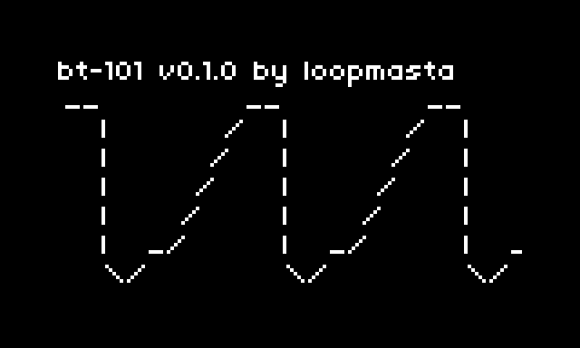

# bt-1O1

an acid bass line in the spirit of the TB-303, with a kick and a hihat.

bt-1O1 is a monophonic 303-style bass voice (saw or square, 4-pole resonant lowpass, accent, slide, drive) played by a 16-step sequencer, plus a kick and a hihat with their own 16-step pattern. it follows the norns clock, so it also syncs to external MIDI clock. the pattern and all settings are saved automatically and come back at the next start.

## requirements

- norns or a norns clone (tested on a shieldXL, Raspberry Pi 4, norns 2.9.4)
- optional: a MIDI clock source

## documentation

three pages, switched with K1 + E1: SEQ, SOUND and DRUM. K3 starts and stops on every page.

### SEQ: the bass line

| control | action |
|---|---|
| E1 | select step |
| E2 | note (C to C) |
| E3 | octave (down / middle / up) |
| K2 | accent |
| K1 + K2 | slide |
| K1 + K3 | note / rest |
| K1 + E3 | pattern length (1–16) |

a slide holds the note into the next step and glides to its pitch, without retriggering. while stopped, editing a step plays its note.

### SOUND: the 303 knobs

| control | action |
|---|---|
| E2 | pick a knob: tune, cutoff, resonance, env mod, decay, accent, wave, drive |
| E3 | change it |
| K2 | drums on / off |
| K1 + K2 | random bass line in the `root` / `scale` from PARAMS |

### DRUM: kick, hihat and the mix

| control | action |
|---|---|
| E1 | select drum step |
| K2 | kick |
| K1 + K2 | hihat: off, closed, open |
| E2 | bass level |
| E3 | drums level |

the drums always loop 16 steps, so a shorter bass line drifts against them. an open hat rings until the next hat.

### sync

bt-1O1 plays sixteenths on the norns clock. with PARAMS > CLOCK > source = midi it follows external MIDI clock; MIDI start restarts at step 1, MIDI stop stops.

### default pattern

Josh Wink, "Higher State of Consciousness", after the transcription on [JonDent's famous 303 bassline patterns](https://djjondent.blogspot.com/2020/04/famous-303-bassline-patterns-page-1.html). kick on the beats, closed hat on the offbeats.

### params

- **SOUND**: tune (±12 semitones), cutoff, resonance, env mod, decay, accent, wave (saw / square), drive, volume
- **SEQUENCER**: length, root, scale (for random)
- **DRUMS**: drums on / off, drums level, kick level / tune / decay, hat level, closed decay, open decay

### files

- `dust/data/bt-1O1/pattern.lua`: the bass and drum patterns
- `dust/data/bt-1O1/last.pset`: the params, written on exit

## install

copy `bt-1O1.lua` and `lib/` to `dust/code/bt-1O1/`.

bt-1O1 brings its own SuperCollider engine (`lib/Engine_Bt1o1.sc`). after installing or updating, **restart norns once** (SYSTEM > RESTART), so SuperCollider picks it up.
